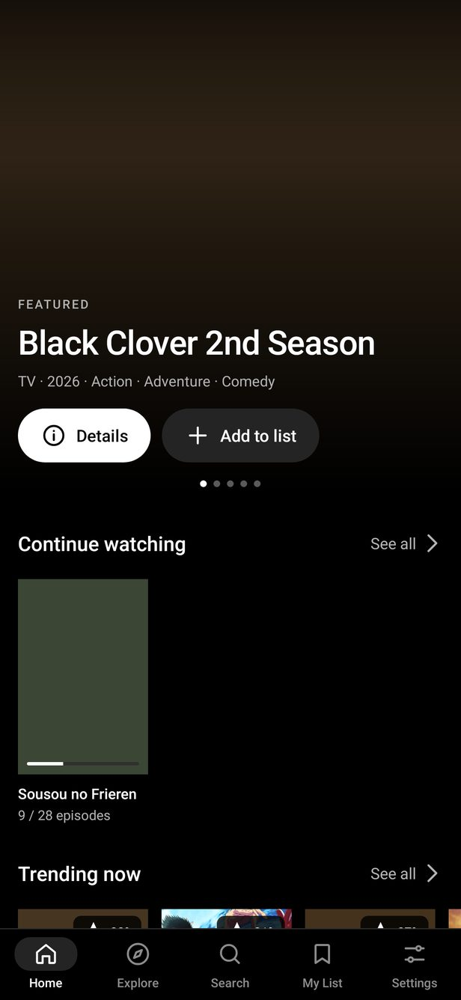
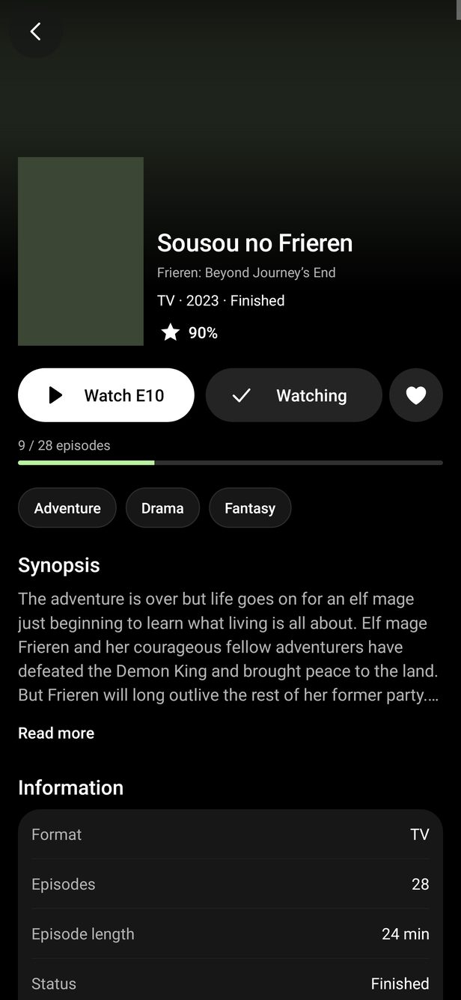
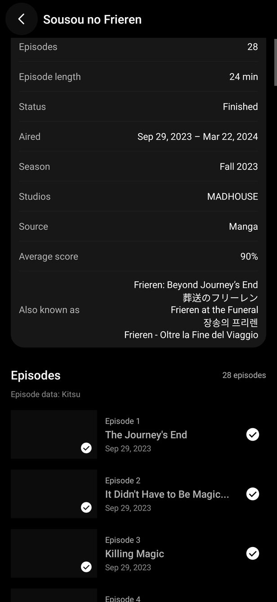
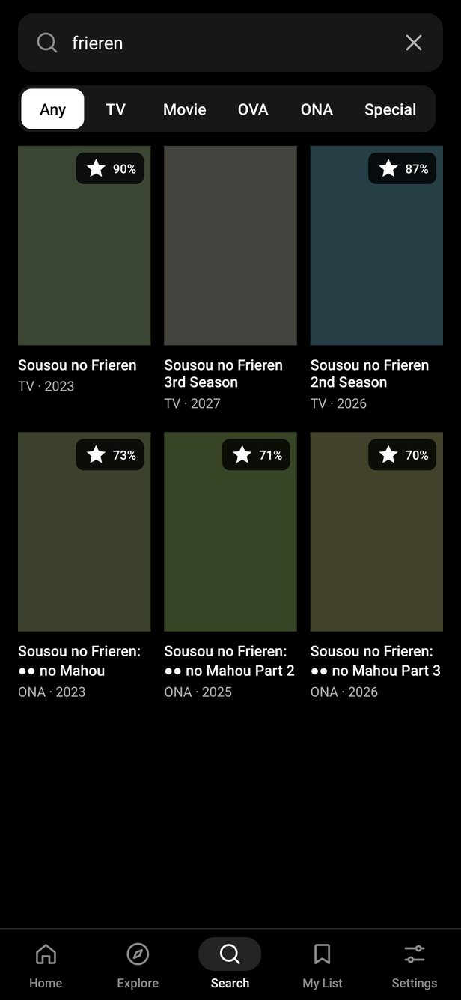
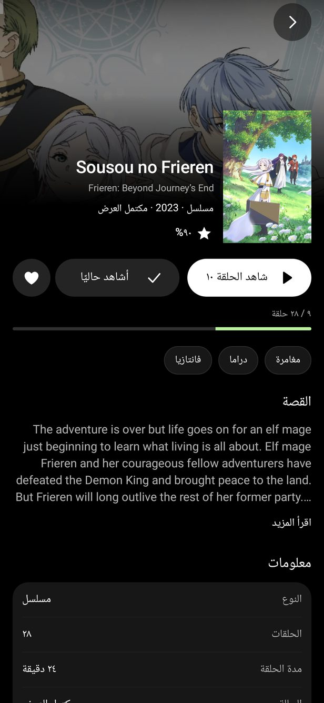
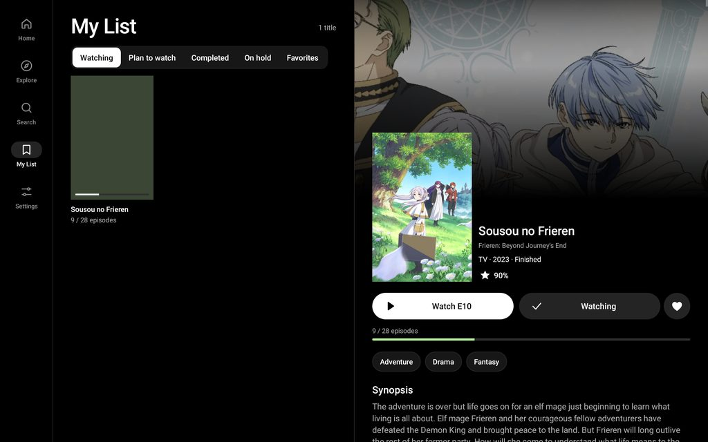
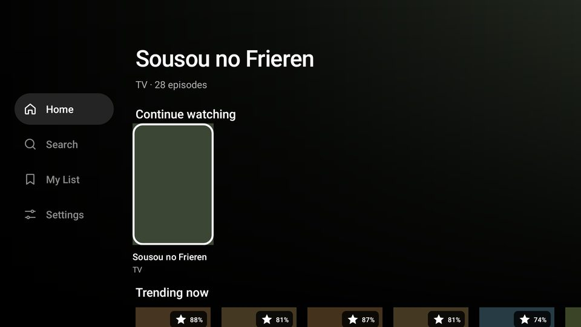

# Kuro — anime discovery & tracking for Android

Java 17 + XML only (no Kotlin, no Compose). Premium monochrome dark UI. Phones, foldables,
tablets and Android TV. English and Arabic (full RTL). Playback is **not** implemented: there is a
documented hook for your own streaming API.

<p>





</p>
<p>


</p>

> Screens rendered by the Robolectric test suite from recorded real API data. Some posters show
> their colour placeholder because images were still loading when the frame was captured.

## ملخص بالعربية

تطبيق أندرويد لاستكشاف الأنمي ومتابعته مكتوب بـ Java وXML فقط، بهوية داكنة أحادية اللون. يعمل
على الهواتف والأجهزة القابلة للطي والأجهزة اللوحية (شريط تنقل سفلي أو جانبي حسب عرض النافذة، مع
عرض «قائمة–تفاصيل» على الشاشات الكبيرة) وعلى Android TV بواجهة مستقلة تعتمد على الريموت.
يدعم العربية والإنجليزية مع اتجاه RTL كامل.

- **البيانات:** ‏AniList هو المصدر الرئيسي للكتالوج، وKitsu لعناوين الحلقات وتواريخها وصورها
  المصغرة الحقيقية (بمطابقة معرّفات موثّقة لا بالأسماء)، وJikan كمصدر احتياطي. لا توجد مفاتيح
  API داخل التطبيق. التفاصيل في `docs/DATA_SOURCES.md`.
- **المشاهدة:** غير منفّذة عمدًا. نقطة الربط هي الواجهة `EpisodePlaybackProvider`، وطريقة ربط
  الـ API الخاص بك في `docs/PLAYBACK_INTEGRATION.md`.
- **السيارات:** غير مدعومة، لأن سياسات Google لا تسمح بهذه الفئة من التطبيقات على Android Auto
  وAndroid Automotive. التفاصيل في `docs/PLATFORMS.md`.
- **iPad:** التصميم مناسب لأحجام شاشات iPad، لكن ملف APK لا يعمل على iPadOS.

## Features

| Screen | What it does |
|---|---|
| **Home** | Featured carousel; Continue watching (local progress); Trending, This season, Currently airing, Top rated, Upcoming, All-time popular; each row has "See all" (paged grid). Pull to refresh. |
| **Explore** | Sort (popular, trending, score, newest, A–Z) and filter by genre, year, season, format and status; responsive infinite grid; filters kept across navigation. |
| **Search** | 380 ms debounce, progressive (paged) results, format filter, local recent searches, empty/no-result states; master–detail on expanded windows. |
| **Details** | Banner + cover, titles, score, status, studios, season, source, alternative titles, expandable synopsis, genres, next-episode countdown; episodes in ranges of 100 (1–100, 101–200…) with real thumbnails when available, dates, filler/recap badges and watched toggles ("mark 1–N watched"); related titles, characters (with Japanese VA), staff, recommendations. Watch button goes through the playback hook. |
| **My List** | Watching, Plan to watch, Completed, On hold, Favorites, with progress bars; long-press to change status; auto-moves to Completed when the last episode of a finished series is watched. |
| **Settings** | Language (system / English / العربية, per-app locales), title language (romaji / English / Japanese), image quality (data saver), grid density, hide spoilers (blurs thumbnails and titles of unwatched episodes), cache size + clear, clear history, reset list, data sources, playback source, version. |
| **TV** | Separate D-pad UI: side menu, focus-reactive hero and backdrop, rows that remember focus, genre browsing, search, library rows, TV title page. |

Every network screen has skeleton loading, clear errors with retry, an offline state, and a
"saved data" banner when it falls back to the cache.

## Architecture

```
app/src/main/java/app/kuro/anime/
├── core/        AppError (classified failures), Resource, executors, WindowSizeClass, DeviceProfile
├── data/
│   ├── model/   Source-independent models: Anime, Episode, EpisodeChunk, AnimeQuery, LibraryEntry…
│   ├── net/     OkHttp client: per-host RateLimiter, Retry-After, bounded retries; NetworkMonitor
│   ├── local/   SQLite: response cache, library, watched episodes, search history
│   ├── source/  Adapters: anilist/ (GraphQL), kitsu/ (JSON:API), jikan/ (REST) → unified models
│   └── repo/    AnimeRepository (cache → AniList → Jikan → stale), EpisodeRepository (merge by
│                number), LibraryRepository, SearchHistoryRepository, SettingsStore
├── playback/    EpisodePlaybackProvider contract (no implementation, by design)
└── ui/          common/ (design system widgets, adapters, paging), main/, home/, explore/,
                 search/, list/, details/, browse/, settings/, tv/
```

- UI → ViewModel (LiveData) → repositories → sources/cache. Views never touch the network or
  the database.
- AndroidX AppCompat, Fragment, RecyclerView, Lifecycle, SwipeRefreshLayout; OkHttp; Glide.
  Parsing uses the platform's `org.json`, with no reflection. No Material Components: the design
  system (segmented control, navigation bar/rail, chips, cards, focus rings, state views) is built
  in-house.
- ViewBinding throughout. Edge-to-edge with inset handling. HTTPS only.

## Build

Requirements: JDK 17+ (built here with JDK 21), Android SDK platform 37 and build-tools 37.0.0.
The Gradle wrapper (9.9.1) and AGP 9.5.1 are included.

```bash
cd AnimeApp
echo "sdk.dir=/path/to/Android/sdk" > local.properties   # or set ANDROID_HOME
./gradlew assembleDebug          # app/build/outputs/apk/debug/app-debug.apk
./gradlew assembleRelease        # R8-shrunk, unsigned (~1.1 MB); sign with your own keystore
./gradlew testDebugUnitTest      # 45 tests, incl. screenshot renders → app/build/screenshots
./gradlew lintDebug              # 0 errors
```

`minSdk 26`, `targetSdk 37`, `compileSdk 37`. `settings.gradle` lists Google's mirror of Maven
Central first (more reliable on proxied networks); you can remove it if you don't need it.

## Testing status

- **45 automated tests, all passing:**
  - Mappers tested against real recorded AniList and Kitsu responses (`app/src/test/resources/fixtures`).
  - Episode merge, ID-mapping verification, rate limiter, cache (fresh/stale/no poisoning).
  - Library rules: orphan cleanup, auto-Watching, completion, MAL→AniList key migration.
  - Robolectric renders of phone (EN/AR-RTL), tablet (rail, master–detail, wide details) and TV
    (initial D-pad focus asserted; phone launcher redirects to the TV shell on TVs).
- Every GraphQL query in the app was run against the live AniList API.
- **Not verified:**
  - Not run on a physical device or emulator (none available in the build environment). Install
    the debug APK on a phone, a tablet and a TV before release.
  - The Jikan API couldn't be reached from the build machine, so its parsers are tested against
    samples written to its documented v4 schema rather than live responses.

## Docs

- [`docs/DATA_SOURCES.md`](docs/DATA_SOURCES.md): source comparison, choices, caching, limits,
  and what the data can't provide.
- [`docs/PLATFORMS.md`](docs/PLATFORMS.md): adaptive layouts, TV, iPad note, car policy findings.
- [`docs/PLAYBACK_INTEGRATION.md`](docs/PLAYBACK_INTEGRATION.md): how to connect your streaming API.

Anime data © AniList, Kitsu and MyAnimeList contributors. Kuro is not affiliated with these services.
