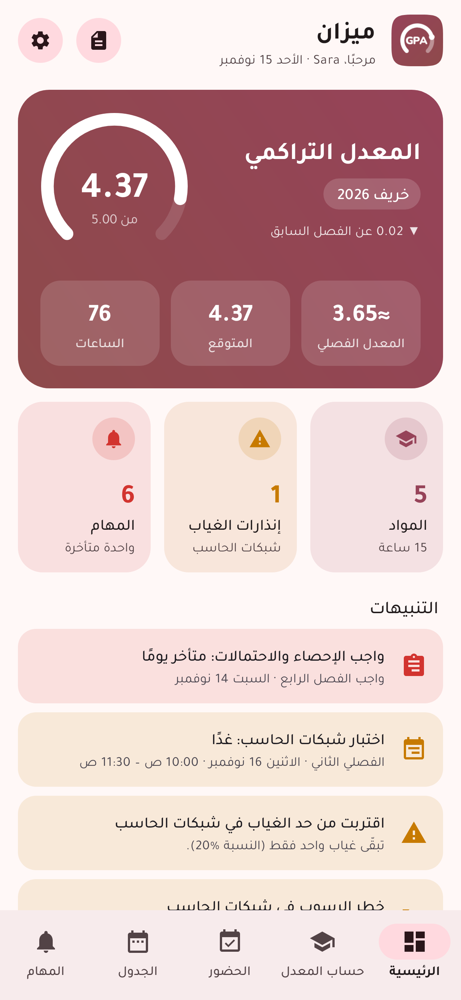
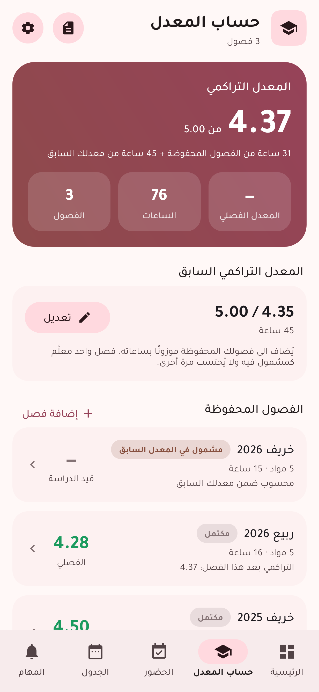
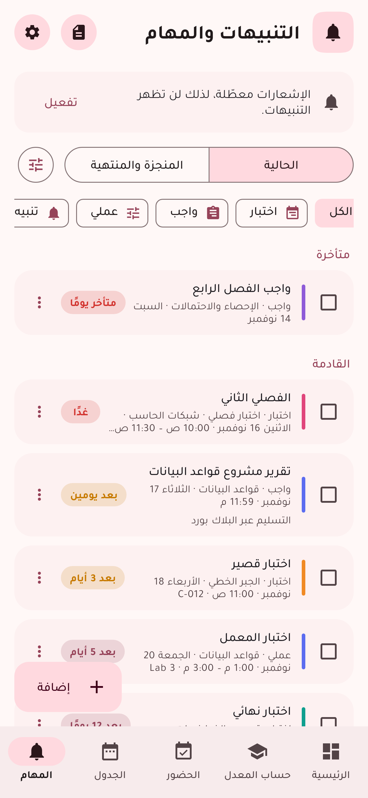
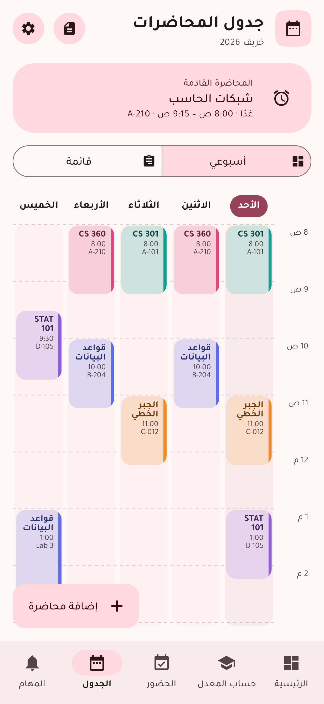
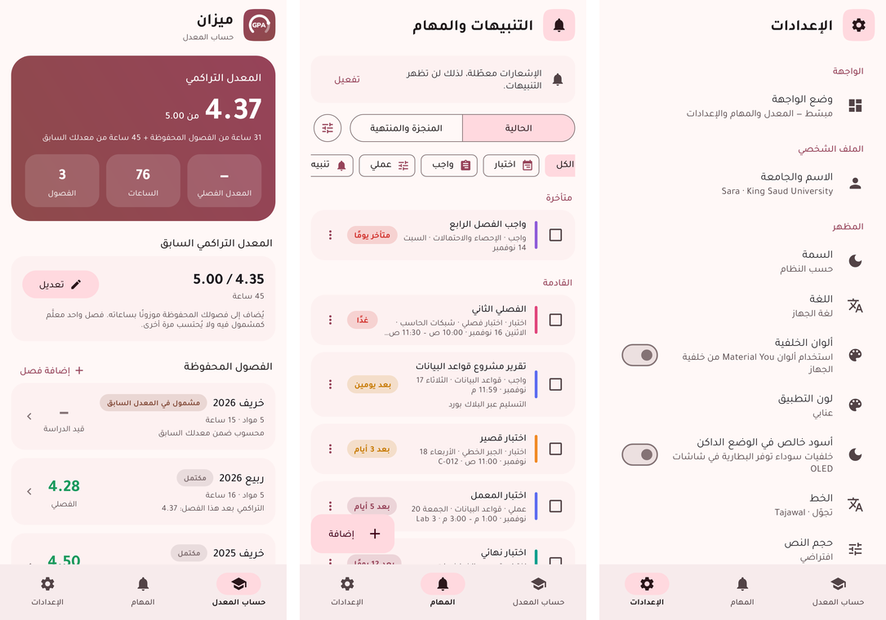
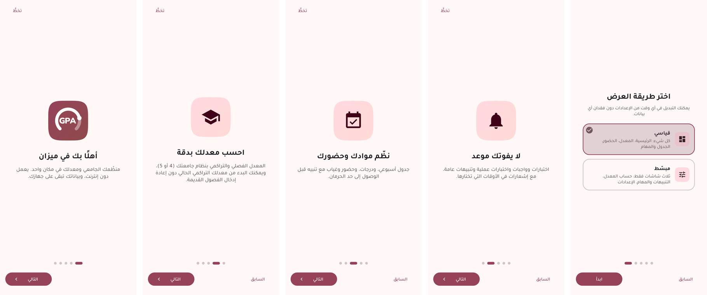
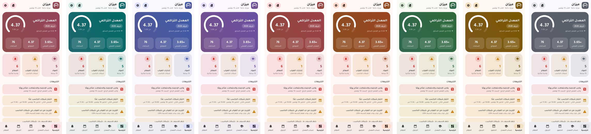
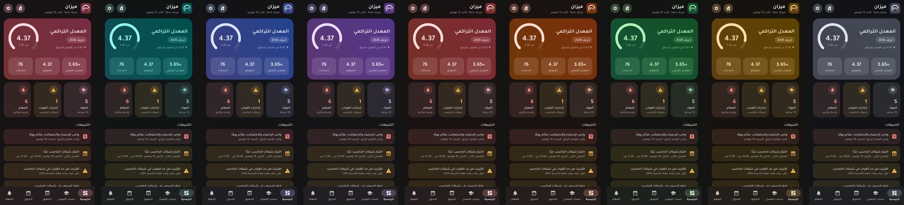
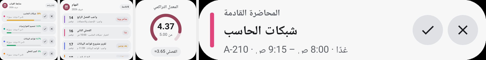

# ميزان — Mizan: GPA, Attendance & Tasks

<div dir="rtl">

تطبيق Android أصلي (Java + XML) لإدارة **المعدل الجامعي والغياب والدرجات والمهام والتنبيهات**. يعمل بالكامل دون إنترنت، بدون تسجيل دخول وبدون قاعدة بيانات: كل البيانات تُحفظ في ملف JSON داخل الجهاز.

**التثبيت السريع:** حمّل `dist/Mizan-1.0.0.apk` على هاتف Android 8.0 أو أحدث وثبّته (يُثبَّت فوق النسخة السابقة دون فقد البيانات).


الأيقونة: عدّاد المعدل كما في التطبيق مع كلمة **GPA** (حروف Nunito Black، رخصة OFL، محوّلة إلى مسارات) وحواف squircle. تُولَّد من `tools/gen_icon.py`.

| الرئيسية | حساب المعدل | التنبيهات والمهام | الجدول الأسبوعي |
|---|---|---|---|
|  |  |  |  |

## المزايا

### 1. وضعان للواجهة: قياسي ومبسّط
- **القياسي:** الرئيسية، حساب المعدل، الحضور، الجدول، التنبيهات والمهام.
- **المبسّط:** ثلاثة أقسام فقط — **حساب المعدل**، **التنبيهات والمهام**، **الإعدادات** — بلا لوحات ثقيلة. صفحة المادة تعرض الدرجات والمهام فقط.
- التبديل من **الإعدادات ← وضع الواجهة** في أي وقت. البيانات واحدة ومشتركة، والتبديل لا يحذف شيئًا: الحضور والجدول يبقيان محفوظين ويعودان كما هما في الوضع القياسي.



### 2. شاشة ترحيب عند أول تشغيل
خمس صفحات عربية بحركات MotionLayout (السحب أو الأزرار): المعدل، تنظيم المواد والحضور، التنبيهات، ثم **اختيار الوضع**. تُحفظ محليًا ولا تتكرر. تدعم زر الرجوع، تدوير الشاشة، قارئ الشاشة (تُعلَن كل صفحة)، وخيار «إزالة الحركات» في النظام (تنتقل الصفحات فورًا). المستخدمون الحاليون لا يرونها بعد التحديث.



### 3. حساب المعدل
- المعدل الفصلي والتراكمي بنظام **5** أو **4** (السعودية، أو A–F مع +/−) أو نظام مخصص بالكامل؛ مواد لا تُحتسب (ناجح/راسب أو معادة)؛ سجل الفصول والرسم البياني.
- **المعدل التراكمي السابق:** أدخل معدلك الحالي و**عدد الساعات المحتسبة** دون إعادة إدخال الفصول القديمة. يُحسب كفصل واحد موزون بساعاته. إن لم تُعرف الساعات يُحفظ المعدل للعرض فقط ولا يدخل في الحساب (لا رقم مختلق)، والمعدل الأعلى من حد النظام لا يُحتسب ويظهر تحذير.
- **منع الاحتساب المزدوج:** إذا أدخلت لاحقًا فصلًا قديمًا داخلًا في معدلك السابق، علِّمه «مشمول في المعدل السابق» (عند إضافته أو من قائمته) فيبقى في السجل ولا يُحسب مرتين. تُشرح السياسة في الشاشة نفسها.
- **حاسبة سريعة (غير محفوظة):** صفوف مؤقتة (مادة، ساعات، تقدير) تحسب معدلها، ومع خيار «دمجها مع سجلي» تحسب التراكمي معها. الصفوف الناقصة تُتجاهل ويُذكر عددها. يمكن حفظها كفصل جديد. حلّت محل شاشة «التوقعات».

### 4. الغياب
- حاضر / غائب / متأخر / بعذر بضغطة، مع التراجع، أو من إشعار المحاضرة أو الودجت.
- **سجل واحد لكل مادة في كل يوم:** الضغط على «غائب» مرة ثانية في اليوم نفسه لا يضيف غيابًا آخر (رسالة «مسجّل مسبقًا»)، وتغيير الحالة يعدّل سجل اليوم. يُفرض ذلك في الواجهة وفي طبقة الحفظ، والملفات القديمة التي فيها غيابات مكررة لليوم نفسه تُدمج تلقائيًا.
- **غيابات بدون تاريخ:** عدد صريح يُضاف إلى إجمالي الغياب دون اختراع تواريخ، قابل للتعديل والحذف، مع تفصيل «X بتاريخ + Y بدون تاريخ».
- قواعد الحرمان كما هي: النسبة (25% افتراضيًا)، البلوغ أو التجاوز، الغياب بعذر، التأخيرات، ونسبة لكل مادة.

### 5. التنبيهات والمهام
- أربعة أنواع: **اختبار**، **واجب**، **عملي**، **تنبيه عام**؛ لكل منها عنوان، مادة اختيارية، تاريخ ووقت اختياريان، ملاحظات اختيارية (لا تظهر مساحة فارغة إن لم توجد)، وحالة الإنجاز.
- تصفية حسب النوع، «الحالية» و«المنجزة والمنتهية»، وترتيب حسب التاريخ أو المادة أو النوع، مع أقسام **متأخرة** و**القادمة** و**بدون تاريخ**.
- التذكير قبل الموعد بأيام (في وقت تختاره) وفي اليوم نفسه قبل الوقت بدقائق/ساعات، افتراضيًا أو مخصصًا لكل مهمة. **لا تذكير ولا أيقونة جرس** لمهمة بلا تاريخ أو منجزة، أو عند منع الإشعارات (مع زر لطلب الإذن).
- إشعار الواجب فيه زر «تم». المنبه يُعاد ضبطه بعد إعادة التشغيل وتغيير الوقت أو المنطقة، والتذكير الفائت يظهر بصياغة صحيحة.
- القسم نفسه في الوضعين، وفي صفحة كل مادة.

### 6. إضافة المادة برقم CRN
- حقل **CRN اختياري**. إن طابق مادة أدخلتها سابقًا في فصل آخر يقترح التطبيق استخدام بياناتها (الاسم، الرمز، الساعات)؛ لا يوجد بحث عبر الإنترنت ولا بيانات مخترعة.
- التحقق حسب إعداد **صيغة CRN** (أي صيغة، أو عدد أرقام محدد مثل 5) لأن الصيغة تختلف بين الجامعات.
- يمنع تكرار CRN في الفصل نفسه، ويسمح به في فصول مختلفة (إعادة المادة).

### 7. الدرجات
- اختبارات قصيرة، فصلي، واجبات، مشاريع، عملي، مشاركة، نهائي، مع «الدرجة من» و«الوزن»؛ المجموع والنسبة والتقدير المتوقع.
- **ما تحتاجه في النهائي** لكل تقدير، أو «مضمون» أو «غير ممكن».

### 8. التصميم
- هوية **عنابية** (الافتراضي للتثبيت الجديد؛ من اختار لونًا سابقًا يبقى عليه)، وضع ليلي ونهاري، **أسود خالص** لشاشات OLED، وثيمات: عنابي، فيروزي، أزرق، بنفسجي، وردي، برتقالي، أخضر، ذهبي، رمادي، أو Material You.

| الثيمات (فاتح) | الثيمات (داكن) |
|---|---|
|  |  |

- **الخطوط:** تجوّل (الافتراضي)، القاهرة، IBM Plex Sans Arabic، المراعي، Readex Pro، Noto Kufi Arabic، أو خط النظام، مع إضافة أي خط من ملف وتحكم في حجم النص.
- عربي (RTL) وإنجليزي، أرقام غربية متسقة، تخطيطات للهواتف الصغيرة والوضع الأفقي والأجهزة اللوحية (شريط جانبي).

> **خط ثمانية:** رخصته تمنع إعادة توزيع ملفاته، لذلك لا يأتي مدمجًا. حمّله من الصفحة الرسمية ثم **الإعدادات ← الخط ← إضافة خط من ملف**.

### 9. إضافات
- **جدول المحاضرات** شبكي أسبوعي أو قائمة حسب اليوم، وتذكير قبل المحاضرة مع زري حاضر/غائب.
- **خمس ودجت:** متابعة الغياب، جدول الأسبوع، **المهام القادمة**، المعدل التراكمي، المحاضرة القادمة.
- اختصارات: الحضور، الجدول، المهام، حساب المعدل. تقرير PDF، نسخ احتياطي واستعادة بملف JSON، وبيانات تجريبية.



</div>

## Features (English)

- **Two modes**: *Standard* (Home, GPA, Attendance, Schedule, Tasks) and *Lite* (exactly GPA Calculator, Reminders & Tasks, Settings). Switch any time in Settings; both read the same data and switching never deletes anything.
- **First-launch onboarding**: five Arabic RTL pages built with MotionLayout, ending with the mode choice. Saved locally, never replayed; supports back, rotation, TalkBack announcements and the system "remove animations" setting. Existing users skip it after updating.
- **GPA**: 5-point, 4-point or custom scales; courses excluded from GPA; trend chart. A **manual cumulative baseline** (current cumulative GPA + GPA hours) counts as one weighted block. Without hours it is kept for reference only; above the scale it is not counted. Older semesters already inside the baseline can be marked "included in previous GPA" so they are never counted twice.
- **GPA Calculator** (replaces the forecast screen): temporary, unsaved rows (course, hours, grade) give their GPA and, optionally, the cumulative GPA combined with saved records; incomplete rows are ignored and reported; rows can be saved as a semester.
- **Attendance**: one record per course per calendar day (enforced in the UI and when saving; old duplicate same-day absences are merged on load); **undated absences** as an explicit count included in totals; deprivation rules unchanged.
- **Reminders & Tasks**: exams, assignments, practical work and general reminders with optional course, date, time and notes, done state, filters, sorting, and overdue / upcoming / undated sections. Notifications only for dated, open tasks when notifications are allowed; re-armed after reboot and time changes.
- **CRN**: optional field; offers to reuse details of a matching course you entered before (no online lookup); format check follows the configured CRN rule; duplicates blocked within a semester, allowed across semesters.
- **Marks**, **schedule**, **lecture reminders**, **PDF report**, **JSON backup/restore**, **widgets** (attendance, weekly schedule, upcoming tasks, GPA, next lecture), 9 color themes with burgundy as the new default, pure black, 6 bundled Arabic fonts, imported fonts, text size, Arabic and English.

## How the numbers are calculated

| | Rule |
|---|---|
| GPA | Σ(grade points × credit hours) ÷ Σ(credit hours), over courses that count in the GPA and have a grade. The official GPA uses final grades only. |
| Cumulative | Baseline (GPA × hours, only when both are valid) + every semester, except semesters marked "included in previous GPA" while a valid baseline exists. |
| Calculator | Same GPA formula over the temporary rows; rows without hours > 0 or a grade from the active scale are ignored. Combined = cumulative points + row points over cumulative hours + row hours. |
| Rounding | GPA values are shown with 2 decimals, rounded half up on the decimal value (3.125 → 3.13, 3.145 → 3.15). |
| Course percentage | Marks earned ÷ marks graded. The course total is the larger of its total marks (100) and the sum of all weights; marks not assigned to any assessment count as still to come. |
| Needed in the final | (grade minimum × course total − marks earned) ÷ remaining marks. With "round percentages" on, the minimum is lowered by 0.5. |
| Absence % | counted absences (dated + undated) ÷ planned lectures. Planned lectures are set per course, or weekly lectures × teaching weeks. At most one record per course per date. |
| Task reminders | "N days before": the date minus N days, at the chosen time of day. "M minutes before": the start time minus M minutes (0 = at the start); needs a time. No date, or done → no reminder. |
| Allowed absences | Rule "reach": the largest *a* with *a* < limit × lectures. Rule "exceed": the largest *a* with *a* ≤ limit × lectures. Example: 40 lectures at 25% → 9 ("reach") or 10 ("exceed"). |

These rules are covered by unit tests in `CalculatorsTest`, `MizanV2Test` (baseline, calculator, rounding, attendance de-duplication, undated absences, CRN, task states, v1 → v2 migration) and `notify/ReminderTest`; `ModesTest` checks the Lite/Standard navigation, that switching keeps data, and onboarding persistence.

## Technical

- Native Android, **Java + XML only**, minSdk **26**, targetSdk/compileSdk **36**.
- Libraries: AndroidX AppCompat, Core, ConstraintLayout (MotionLayout) and Material Components. Charts, the GPA ring, the weekly timetable and the PDF report are drawn in plain Java (Canvas, `PdfDocument`); there is no chart, database or network library.
- Fonts are in `app/src/main/assets/fonts/` with their SIL Open Font License files in `assets/fonts/licenses/`. Fonts the user imports are copied to private storage and grouped into families by file name (`Family-Bold.otf`). Color themes are generated with one Material 3 recipe from a seed color each: primary at a shared chroma, muted secondary in the same hue, tertiary in a neighbouring hue (+35°), and lightly tinted neutral surfaces, using the standard light/dark tones (`res/values*/colors_themes.xml`, `md_*` in `colors.xml` for the default teal).
- **No INTERNET permission.** Data is one JSON document in the app's private storage (`mizan-data.json`), written atomically with `AtomicFile`; the first save of each run keeps the previous file as a safety copy. Cloud backup is disabled; backups are files the user saves through the system file picker.
- Reminders use a single exact alarm that always points at the earliest upcoming lecture or task reminder and re-arms itself after it fires, after reboot, and after time or time-zone changes.
- Data format version 2. Files from earlier versions are migrated on load: course exams become tasks, duplicate same-day absences are merged, existing users are marked as onboarded in Standard mode and keep their color theme. Nothing is dropped; the previous file is kept as a safety copy on the first save.
- Onboarding uses ConstraintLayout's MotionLayout (`res/xml/onboarding_scene.xml`).

```
app/src/main/java/com/mizan/gpa/
├── data/      models (AppData, Semester, Course, Task, Assessment, AttendanceRecord, LectureSlot, GradeScale, Settings), JSON, migration, Repository
├── calc/      GpaCalculator, MarksCalculator, GradeResolver, AttendanceCalculator, TaskReminders  (pure Java, unit-tested)
├── ui/        activities (Main, Onboarding, Course, Semester, Settings), fragments, dialogs, custom views (GpaRingView, TrendChartView)
├── notify/    reminder scheduling, notifications, boot receiver, notification actions
├── widget/    home-screen widgets (attendance, weekly schedule, upcoming tasks, GPA, next lecture)
├── util/      formatting, fonts (Fonts), color themes (Themes), UI helpers
└── export/    PdfReport, backup/restore (DataTransfer), SampleData
```

### Build

Requires JDK 17+ and the Android SDK (platform 36). Create `local.properties` with `sdk.dir=/path/to/Android/sdk`, then:

```bash
./gradlew assembleDebug          # app/build/outputs/apk/debug/app-debug.apk
./gradlew assembleRelease        # minified; signed with the debug key — use your own key before publishing
./gradlew testDebugUnitTest      # calculation tests + screenshot smoke tests (writes PNGs to screenshots/)
./gradlew lintDebug
```

The screenshot tests use Robolectric's native graphics to render every screen in English, Arabic, dark mode, Lite mode, every onboarding page, a compact 320dp phone, landscape, other palettes and fonts, and a tablet, plus the widgets and the PDF report pages. They are smoke tests (they fail on crashes, not on pixel changes); the images were reviewed by eye.

> The APK in `dist/` is signed with a local debug key. To install a build signed with a different key, uninstall the old app first. Use **Backup** to keep your data before you do.
