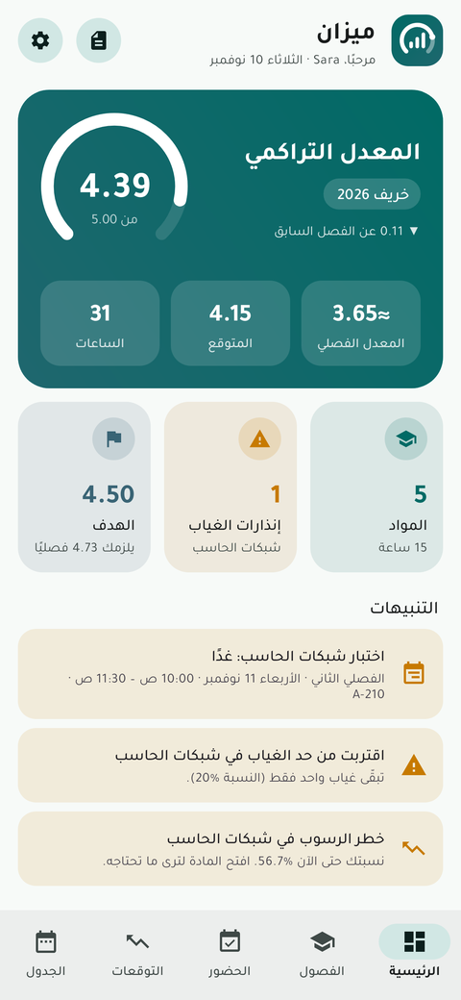
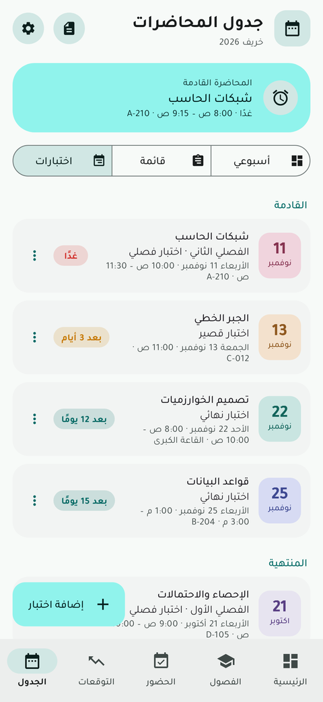
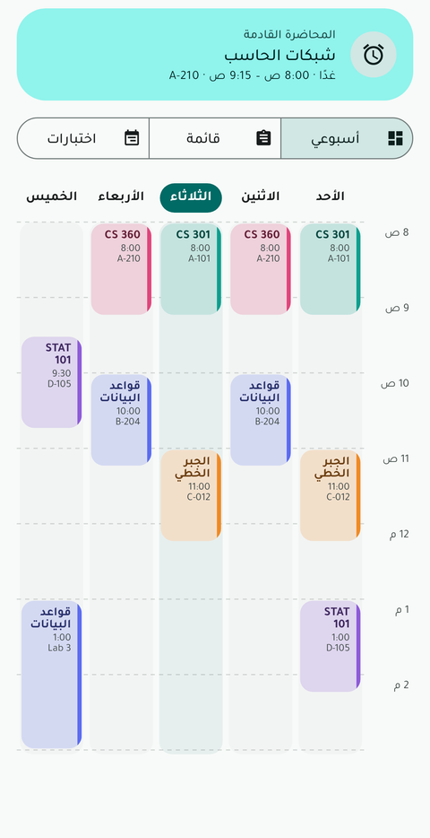
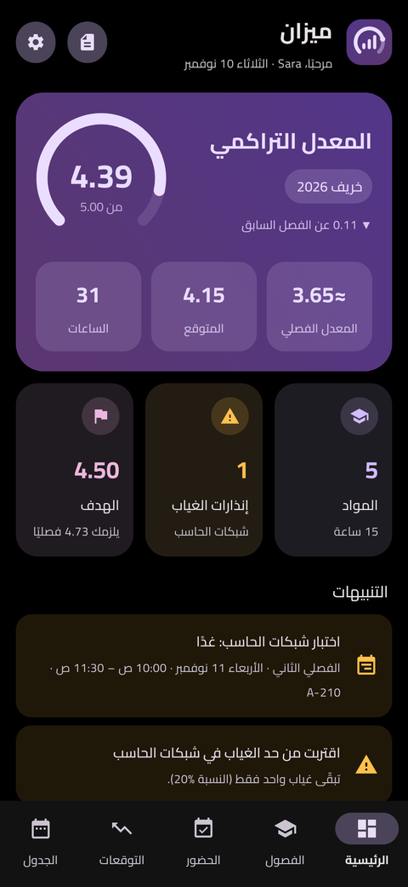
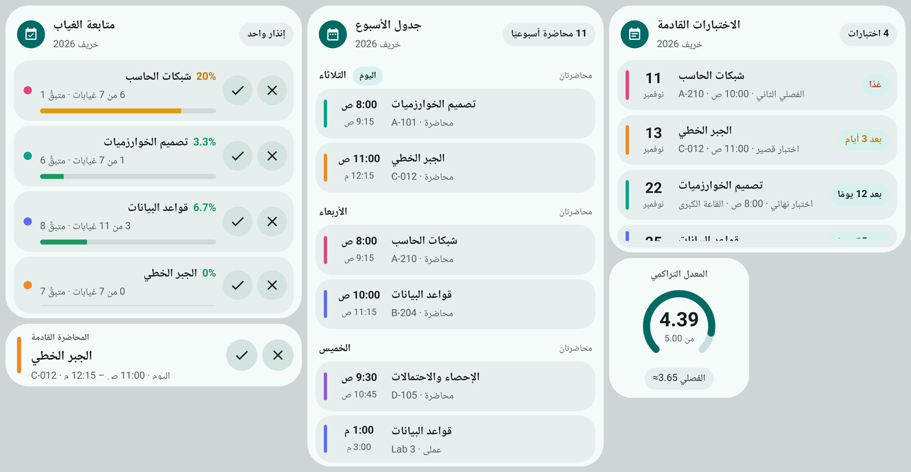
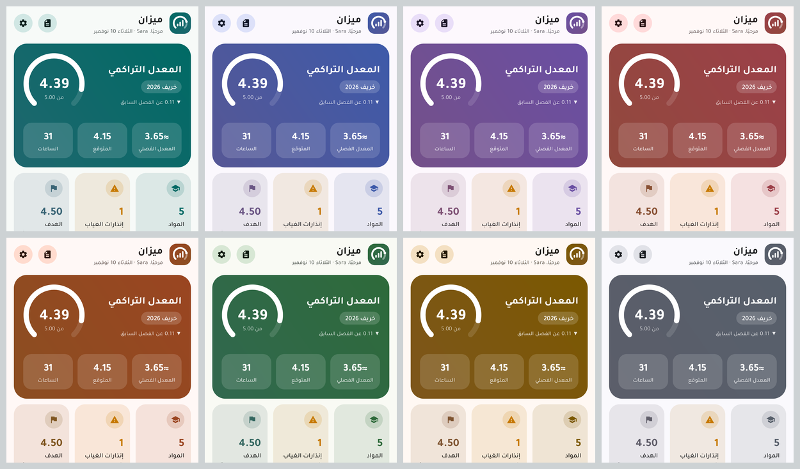
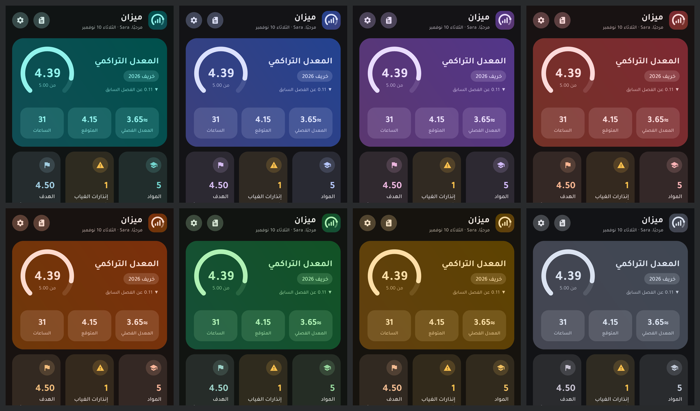

# ميزان — Mizan: GPA, Attendance & Forecasts

<div dir="rtl">

تطبيق Android أصلي (Java + XML) لإدارة **المعدل الجامعي والغياب والدرجات وتوقعات المعدل**. يعمل بالكامل دون إنترنت، بدون تسجيل دخول وبدون قاعدة بيانات: كل البيانات تُحفظ في ملف JSON داخل الجهاز.

**التثبيت السريع:** حمّل `dist/Mizan-1.2.1.apk` على هاتف Android 8.0 أو أحدث وثبّته.


| الرئيسية | الاختبارات | الجدول الأسبوعي | ألوان وخطوط |
|---|---|---|---|
|  |  |  |  |



## المزايا

### 1. حساب المعدل
- المعدل الفصلي والتراكمي، بنظام **5** (السعودية) أو **4** (السعودية، أو A–F مع +/−) أو نظام مخصص بالكامل (الرموز، النقاط، الحد الأدنى للنسبة).
- إضافة وتعديل وحذف الفصول والمواد والساعات والتقديرات، وترتيب الفصول.
- مواد لا تُحتسب في المعدل (ناجح/راسب أو مادة معادة).
- «الدراسة السابقة»: إدخال معدل تراكمي وساعات سابقة دون إدخال كل الفصول القديمة.
- سجل أكاديمي ورسم بياني لتطور المعدل الفصلي والتراكمي.

### 2. الغياب
- تسجيل حاضر / غائب / متأخر / بعذر بضغطة واحدة، مع التراجع، أو من إشعار المحاضرة مباشرة.
- نسبة الغياب تلقائيًا، وعدد الغيابات المتبقية قبل الحرمان، وسجل كامل قابل للتعديل.
- إعدادات الحرمان: النسبة (افتراضيًا 25%)، الحرمان عند **بلوغ** الحد أو **تجاوزه**، احتساب الغياب بعذر، وكم تأخيرًا يساوي غيابًا. ويمكن تخصيص النسبة لكل مادة.
- تنبيهات (داخل التطبيق وإشعارات) عند الاقتراب من الحرمان.

### 3. التوقعات
- المعدل المتوقع (الفصلي والتراكمي) من الدرجات المسجلة أو التقدير المتوقع.
- أفضل وأسوأ معدل ممكن.
- محاكي سيناريوهات: اختر تقديرًا لكل مادة وشاهد المعدل فورًا.
- المعدل المستهدف: المعدل الفصلي المطلوب للوصول إليه، أو عدد الساعات اللازمة إن لم يكن ممكنًا هذا الفصل.

### 4. الدرجات
- اختبارات قصيرة، فصلي، واجبات، مشاريع، عملي، مشاركة، نهائي، مع «الدرجة من» و«الوزن».
- المجموع والنسبة والتقدير المتوقع لكل مادة.
- **ما تحتاجه في النهائي** لكل تقدير (مثلًا: تحتاج 36 من 40 للحصول على C)، أو «مضمون» أو «غير ممكن».

### 5. لوحة التحكم
المعدل التراكمي بعدّاد متحرك، والمعدل الفصلي والمتوقع، والساعات، وملخص المواد والغياب، والتنبيهات، والرسم البياني.

### 6. التصميم
- Material 3 بهوية مستقلة، وضع ليلي ونهاري (أو حسب النظام)، و**أسود خالص** لشاشات OLED.
- **ثيمات ألوان:** فيروزي، أزرق المحيط، بنفسجي، وردي، برتقالي الغروب، أخضر الغابة، ذهبي، رمادي، أو ألوان Material You من الخلفية. كل الثيمات مبنية بقاعدة Material 3 واحدة (نفس درجات الحاويات والأسطح، ولون ثالثي مجاور للأساسي)، والشعار والتقرير والإشعارات تتبع الثيم المختار.

| الثيمات (فاتح) | الثيمات (داكن) |
|---|---|
|  |  |
- **الخطوط:** تجوّل (الافتراضي)، القاهرة، IBM Plex Sans Arabic، المراعي، Readex Pro، Noto Kufi Arabic، أو خط النظام، مع **إضافة أي خط من ملف** (TTF/OTF) وتحكم في **حجم النص**.
- عربي (من اليمين لليسار) وإنجليزي مع تبديل اللغة من داخل التطبيق، حركات انتقالية، وتخطيط للأجهزة اللوحية بشريط تنقل جانبي.

> **خط ثمانية:** رخصة خط ثمانية تسمح باستخدامه في التطبيقات لكنها تمنع إعادة توزيع ملفاته، لذلك لا يأتي مدمجًا في التطبيق. حمّله من الصفحة الرسمية لثمانية، ثم من **الإعدادات ← الخط ← إضافة خط من ملف** اختر ملفاته (يمكن اختيار كل الأوزان مرة واحدة وسيجمعها التطبيق كعائلة واحدة).

### 7. تذكير الاختبارات
- أضف اختبارات كل مادة (النوع، التاريخ، الوقت، القاعة، ملاحظة) من تبويب «الاختبارات» في المادة أو من تبويب الجدول.
- **تذكير قبل الاختبار بأيام** (يوم، يومان، 3 أيام، أسبوع، أو قيمة مخصصة) يُرسل في وقت تحدده أنت (افتراضيًا 8:00 م).
- **تذكير في يوم الاختبار** (قبله بـ3 ساعات، ساعتين، ساعة، نصف ساعة، ربع ساعة، وقت الاختبار نفسه، أو قيمة مخصصة بالدقائق).
- إعدادات افتراضية لكل الاختبارات، مع إمكانية **تخصيص التذكيرات لكل اختبار** على حدة.
- نص الإشعار يُحسب من الوقت المتبقي فعلًا («غدًا»، «بعد ساعة»، «الآن»)، والتذكير الذي يفوت والجهاز مطفأ يظهر عند التشغيل.
- عدّ تنازلي لكل اختبار، وتنبيه في الرئيسية لاختبارات اليوم والغد، وبعد انتهاء الاختبار يمكن تسجيل درجته مباشرة.

### 8. إضافات
- **جدول المحاضرات** بطريقتين: جدول أسبوعي شبكي (الأيام أعمدة والساعات صفوف، مع خط الوقت الحالي) أو قائمة حسب اليوم.
- **خمس ودجت:** متابعة الغياب (مع زري ✓ حاضر و✗ غائب)، جدول الأسبوع حسب الأيام، الاختبارات القادمة مع العد التنازلي، المعدل التراكمي، والمحاضرة القادمة (مع زري الحضور والغياب).
- **اختصارات** عند الضغط المطوّل على أيقونة التطبيق: الحضور، الجدول، الاختبارات، توقع المعدل.
- تذكير قبل المحاضرة (مع زري حاضر/غائب في الإشعار)، تقرير PDF، نسخ احتياطي واستعادة بملف JSON، وبيانات تجريبية.

</div>

## Features (English)

- **GPA**: semester and cumulative GPA on 5-point or 4-point scales (Saudi presets, A–F with +/−) or a fully custom scale; courses excluded from GPA; earlier studies entered as one prior GPA + credit hours; GPA trend chart.
- **Attendance**: one-tap present/absent/late/excused (with undo, or straight from the lecture notification); absence rate, absences left before deprivation, full editable log; configurable limit (global or per course), "reach" vs "exceed" rule, excused absences, lates-per-absence; alerts and notifications near the limit.
- **Forecast**: expected semester/cumulative GPA, best and worst case, a what-if simulator, and a target-GPA calculator.
- **Marks**: quizzes, midterms, assignments, projects, labs and finals with score/out-of/weight; totals, percentage, predicted letter, and the score needed in the final for every grade.
- **Dashboard**, **schedule** as a weekly grid or a day list, reminders, **PDF report**, **JSON backup/restore**, **sample data**.
- **Exam reminders**: exams per course with reminders days before (at a time of day you choose) and on the exam day (hours or minutes before, or at the start), as defaults or customized per exam; reminders missed while the phone was off are delivered late with correct wording.
- **Widgets**: absence tracker with one-tap present/absent buttons, weekly schedule by day, upcoming exams with countdowns, cumulative GPA gauge, and next lecture. Launcher shortcuts for attendance, schedule, exams and forecast.
- **Appearance**: 8 color themes (or Material You), pure black dark mode, 6 bundled Arabic fonts (Tajawal by default) or the system font, importing any TTF/OTF font family, and a text-size setting. Arabic (RTL) and English, phone and tablet layouts.

## How the numbers are calculated

| | Rule |
|---|---|
| GPA | Σ(grade points × credit hours) ÷ Σ(credit hours), over courses that count in the GPA and have a grade. The official GPA uses final grades only. |
| Cumulative | Earlier studies (GPA × hours) + every semester. |
| Expected | Final grade, else the expected grade you chose, else the grade predicted from your marks. |
| Course percentage | Marks earned ÷ marks graded. The course total is the larger of its total marks (100) and the sum of all weights; marks not assigned to any assessment count as still to come. |
| Best / worst | Best: full marks in everything left. Worst: no further marks. Courses with no marks yet: top / bottom grade. |
| Needed in the final | (grade minimum × course total − marks earned) ÷ remaining marks. With "round percentages" on, the minimum is lowered by 0.5. |
| Target GPA | (target × (current hours + new hours) − current points) ÷ new hours. |
| Absence % | counted absences ÷ planned lectures. Planned lectures are set per course, or weekly lectures × teaching weeks. |
| Exam reminders | "N days before": the exam date minus N days, at the chosen time of day. "M minutes before": the exam start minus M minutes (0 = at the start). |
| Allowed absences | Rule "reach": the largest *a* with *a* < limit × lectures. Rule "exceed": the largest *a* with *a* ≤ limit × lectures. Example: 40 lectures at 25% → 9 ("reach") or 10 ("exceed"). |

All of these are covered by unit tests in `app/src/test/java/com/mizan/gpa/CalculatorsTest.java`.

## Technical

- Native Android, **Java + XML only**, minSdk **26**, targetSdk/compileSdk **36**.
- Libraries: AndroidX AppCompat, Core and Material Components. Charts, the GPA ring, the weekly timetable and the PDF report are drawn in plain Java (Canvas, `PdfDocument`); there is no chart, database or network library.
- Fonts are in `app/src/main/assets/fonts/` with their SIL Open Font License files in `assets/fonts/licenses/`. Fonts the user imports are copied to private storage and grouped into families by file name (`Family-Bold.otf`). Color themes are generated with one Material 3 recipe from a seed color each: primary at a shared chroma, muted secondary in the same hue, tertiary in a neighbouring hue (+35°), and lightly tinted neutral surfaces, using the standard light/dark tones (`res/values*/colors_themes.xml`, `md_*` in `colors.xml` for the default teal).
- **No INTERNET permission.** Data is one JSON document in the app's private storage (`mizan-data.json`), written atomically with `AtomicFile`; the first save of each run keeps the previous file as a safety copy. Cloud backup is disabled; backups are files the user saves through the system file picker.
- Reminders use a single exact alarm that always points at the earliest upcoming lecture or exam reminder and re-arms itself after it fires, after reboot, and after time or time-zone changes.

```
app/src/main/java/com/mizan/gpa/
├── data/      models (AppData, Semester, Course, Assessment, AttendanceRecord, LectureSlot, GradeScale, Settings), JSON, Repository
├── calc/      GpaCalculator, MarksCalculator, GradeResolver, AttendanceCalculator  (pure Java, unit-tested)
├── ui/        activities, fragments, dialogs, custom views (GpaRingView, TrendChartView, RangeBarView)
├── notify/    reminder scheduling, notifications, boot receiver, notification actions
├── widget/    home-screen widgets (attendance, weekly schedule) and their list factories
├── util/      formatting, fonts (Fonts), color themes (Themes), UI helpers
└── export/    PdfReport, backup/restore (DataTransfer), SampleData
```

### Build

Requires JDK 17+ and the Android SDK (platform 36). Create `local.properties` with `sdk.dir=/path/to/Android/sdk`, then:

```bash
./gradlew assembleDebug          # app/build/outputs/apk/debug/app-debug.apk
./gradlew assembleRelease        # minified; signed with the debug key — use your own key before publishing
./gradlew testDebugUnitTest      # calculation tests + screenshot smoke tests (writes PNGs to screenshots/)
./gradlew lintDebug
```

The screenshot tests use Robolectric's native graphics to render every screen in English, Arabic, dark mode, other palettes and fonts, and on a tablet, plus both widgets and the PDF report pages.

> The APK in `dist/` is signed with a local debug key. To install a build signed with a different key, uninstall the old app first. Use **Backup** to keep your data before you do.
