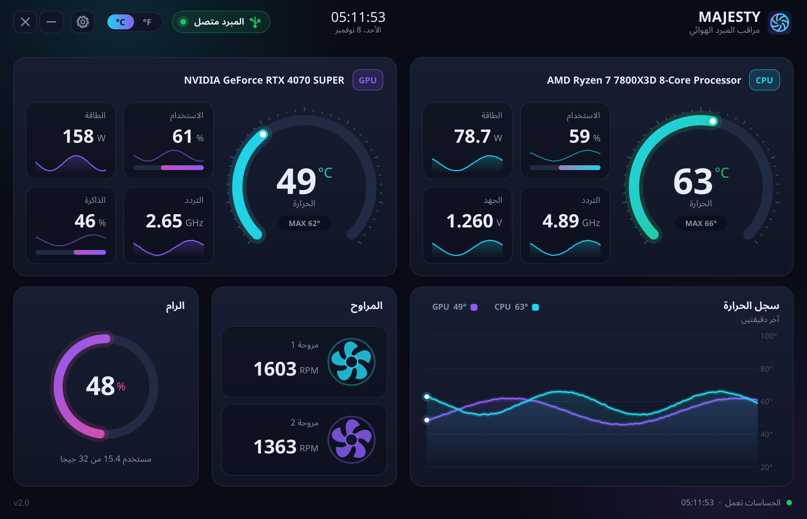
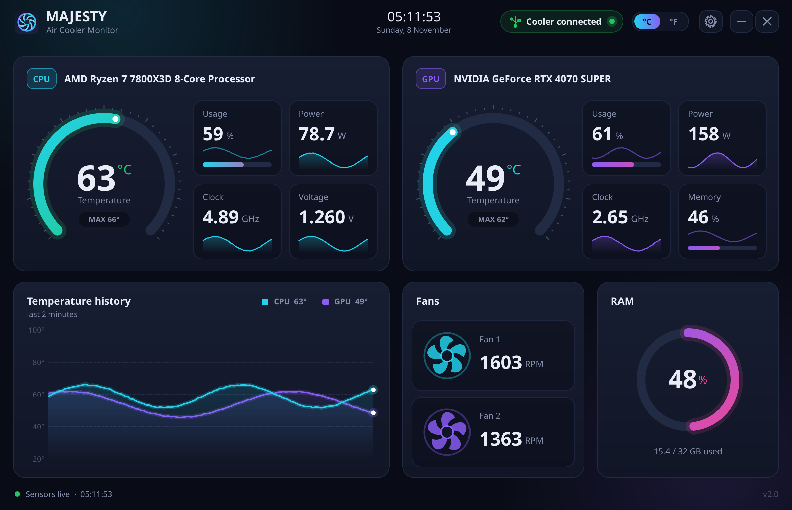

# MAJESTY Air Cooler Monitor 2.0

<div dir="rtl">

برنامج محسَّن لشاشة مبرد **ماجيستي الهوائي**: يقرأ حرارة واستخدام المعالج وكرت الشاشة والمراوح والرام، ويعرضها في واجهة داكنة حديثة، ويرسلها لشاشة المبرد عبر USB.



## التثبيت

1. حمّل الملف `dist/MAJESTY_Air_Cooler_Monitor_2.0.0.msi` وشغّله.
2. افتح **MAJESTY Air Cooler Monitor** من سطح المكتب (يطلب صلاحية المسؤول لقراءة حساسات المعالج).
3. وصّل المبرد، وسيظهر «المبرد متصل» باللون الأخضر.

> لو ظهر تنبيه «حرارة المعالج تحتاج تعريف PawnIO»: اضغط **تثبيت** (أو ثبّته من pawnio.eu) ثم أعد تشغيل البرنامج.
> هذا التعريف مجاني وموقّع، وتستخدمه برامج المراقبة الحديثة بدلاً من WinRing0 القديم الذي يحظره ويندوز ديفندر.

## ما الجديد مقارنة بالنسخة الأصلية 1.2

| | النسخة الأصلية 1.2 | النسخة 2.0 |
|---|---|---|
| التصميم | صورة خلفية ثابتة ونصوص | لوحة داكنة مرسومة بالكامل: عدادات حرارة دائرية، رسوم تاريخ الحرارة، مراوح تدور حسب السرعة |
| اللغة | إنجليزي | عربي (من اليمين لليسار) + إنجليزي |
| اختيار الحساسات | يدوي إجباري لكل قيمة | تلقائي بذكاء، مع إمكانية التغيير من الإعدادات |
| الحساسات | CPUID SDK تجريبي | LibreHardwareMonitor مفتوح المصدر |
| USB | CyUSB.dll | HidSharp، مع إعادة اتصال تلقائية ودعم أكثر من مبرد |
| التشغيل مع ويندوز | مفتاح Run (لا يعمل مع صلاحية المسؤول) | مهمة مجدولة بصلاحية عالية، بدون نافذة UAC عند كل إقلاع |
| الإعدادات | `config.ini` داخل Program Files | `%AppData%\MAJESTY\AirCoolerMonitor\settings.ini` |
| جهد المعالج | خطأ في إرسال الكسر العشري | يُرسل بشكل صحيح (مثل 1.36 V) |
| حجم المثبّت | 30 ميجا | أقل من 2 ميجا |

</div>

## English

An improved monitor app for the MAJESTY air-cooler display: it reads CPU/GPU temperature, load, power, clocks,
voltage, fan speeds and RAM, shows them in a modern dark dashboard (Arabic RTL or English), and streams them to the
cooler over USB HID.



### Features
- Animated dashboard: temperature gauges, 2-minute history chart, per-metric sparklines, spinning fans, RAM ring.
- Automatic sensor selection (CPU Package / Tctl, GPU Core, ...) with per-metric overrides in Settings.
- °C / °F toggle, which is also sent to the cooler display.
- Tray icon with live temps; the close button keeps it running in the tray (configurable).
- Starts with Windows via an elevated scheduled task, so there's no UAC prompt at logon.
- Reconnects automatically when the cooler is plugged in or out; drives several coolers at once.
- Tells the display the PC app is closing (same `0x0F` command as the vendor app).

### Requirements
Windows 10/11 x64 with .NET Framework 4.7.2+ (preinstalled on Windows 10 1803 and later). CPU temperature, power
and clock sensors need the free [PawnIO](https://pawnio.eu/) driver; the app offers a one-click install when it is
missing. GPU sensors, CPU load and RAM work without it.

### Device protocol
USB HID, VID `0x5131`, PID `0x2007`. Each report holds the 3-byte header `00 01 02` followed by 33 value bytes. The
full layout is documented in [`CoolerProtocol.cs`](src/MajestyMonitor/Core/CoolerProtocol.cs) and checked
byte-for-byte by `tests/ProtocolTests`.

### Building
```bash
./build.sh   # runs the protocol tests, builds the exe, and builds dist/*.msi (needs .NET SDK 8+, python3, msitools)
```

Command-line options: `--minimized`, `--demo` (simulated data), `--screenshot out.png [--lang ar|en] [--scale 2]`.

### Layout
```
src/MajestyMonitor/Core   sensors (LibreHardwareMonitor), HID link, protocol, settings, autostart
src/MajestyMonitor/UI     custom-painted dashboard, settings dialog, main window/tray
installer/make_wxs.py     generates the WiX source that wixl turns into the MSI
tests/ProtocolTests       byte-level checks of the cooler payload
```

---

## ميزان — تطبيق Android لإدارة المعدل والغياب

يحتوي المجلد [`MizanGPA/`](MizanGPA/) على تطبيق Android مستقل (Java + XML) لحساب المعدل الفصلي والتراكمي، وإدارة الغياب والدرجات، وتوقع المعدل. التفاصيل وملف التثبيت في [`MizanGPA/README.md`](MizanGPA/README.md).
